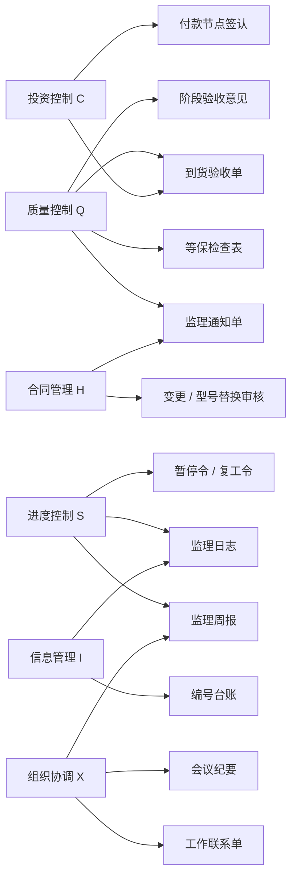

# 信息技术服务监理 Skill 套件

> 按 **GB/T 19668《信息技术服务 监理》“三控两管一协调”** 框架定制的 AI Agent Skills，帮助信息监理人员把现场笔记、合同清单、测评报告快速整理成**可交甲乙方签字盖章、可审核归档**的规范监理文书。
>
> 面向软硬件集成类信息化项目 · 全中文 · 支持 Claude / WorkBuddy / CodeBuddy / Copilot / Codex 等 Agent

## 能做什么

| Skill | 用一句话说 | 产出（Markdown 草稿 → DOCX 正式件） |
|---|---|---|
| `it-supervision-core` | 总控：项目档案、统一编号、签章栏、路由 | 项目档案、编号台账、DOCX 渲染、文书校验 |
| `supervision-plan` | 写监理规划 | 《监理规划》《监理实施细则》 |
| `supervision-log` | 现场笔记 → 规范日志 | 《监理日志》《监理周报》 |
| `supervision-notice` | 发整改通知并跟踪闭环 | 《监理通知单》《回复单》《工程暂停令》《复工令》《工作联系单》 |
| `stage-acceptance` | 里程碑/初验/终验 | 《阶段验收监理意见》+ 遗留问题清单 |
| `mlps-check` | 等保 2.0 全过程监理检查 | 《等保测评监理检查表》《等保整改跟踪表》 |
| `hardware-arrival-check` | 开箱验收 + 清单自动比对 | 《硬件设备到货验收单》+ 序列号明细 + 差异报告 |

### 三控两管一协调如何落到文书



每份文书都带“控制域”字段与统一签章栏（建设单位 / 承建单位 / 监理单位，按文书类型自动选择），编号格式 `JL-<项目简称>-<类型码>-<年份>-<流水号>` 全项目统一。

## 设计原则

- **绝不编造**：日期、数量、金额、序列号、测评分数、标准条款号只来自你提供的资料；缺失标 `【待填】`，正式件校验时会拦截。
- **先草稿后正式**：Agent 先输出 Markdown 让你确认，再渲染 A4 / 仿宋 / 页眉页脚 / 签章栏不跨页的 DOCX。
- **依据可追溯**：每个问题写“事实—依据—要求—期限”，优先引用合同与项目文件。
- **监理口吻**：中立、书面、公文化，内置措辞规范（“承建单位”而非“乙方/施工方”等）。

## 安装

### 方式一：脚本安装（推荐）

```bash
git clone https://github.com/zongyangbigpolo/it-supervision-skills.git
cd it-supervision-skills
./install.sh claude        # Claude Code：~/.claude/skills
./install.sh workbuddy     # WorkBuddy：~/.workbuddy/skills
./install.sh codebuddy     # CodeBuddy：~/.codebuddy/skills
./install.sh copilot       # GitHub Copilot CLI：~/.copilot/skills
./install.sh codex         # Codex：~/.codex/skills
./install.sh project ~/我的监理项目   # 项目级安装
./install.sh path <任意目录>          # 其他 Agent
# 加 --link 使用软链接，git pull 即可更新
python3 -m pip install python-docx    # DOCX 渲染依赖（可选 openpyxl 读 xlsx）
```

> 各 Agent 的 skills 目录可能随版本调整，请以对应工具文档为准；若目录不同，用 `./install.sh path <目录>`。

### 方式二：Claude Code 插件市场

```
/plugin marketplace add zongyangbigpolo/it-supervision-skills
/plugin install it-supervision-skills@it-supervision-skills
```

### 方式三：图形界面导入（WorkBuddy / Claude Desktop 等）

```bash
./install.sh zip   # 生成 dist/it-supervision-skills.zip 及每个 skill 的独立 zip
```

在 Agent 的“技能/Skills”管理页面上传 zip。**6 个子 skill 都依赖 `it-supervision-core`，请一并导入。**

## 使用示例

直接用中文对 Agent 说：

- “帮我建一个监理项目档案，项目是 XX 市智慧政务平台，承建单位 XX 科技……”
- “根据合同附件给这个项目写一份监理规划，有等保三级要求。”
- “今天现场：上午 6 台服务器上架，有一台亮黄灯；下午甲方说要加个报表。整理成监理日志。”
- “服务器到货了，这是合同清单和装箱单 Excel，帮我做到货验收单。”
- “承建单位没按时提交测试报告，给他们发个监理通知单，限期下周五。”
- “这是等保测评报告，帮我出等保测评监理检查表，看能不能进入初验。”
- “准备初验，帮我列验收资料清单并起草验收监理意见。”

完整示例见 [examples/](examples/)。

### 命令行脚本

```bash
CORE=skills/it-supervision-core/scripts
python3 $CORE/next_doc_no.py --type TZ --title "关于测试报告逾期的通知"   # 分配编号
python3 $CORE/validate_doc.py 监理资料/03-监理通知单/xxx.md --final       # 校验
python3 $CORE/md_to_docx.py 监理资料/03-监理通知单/xxx.md -o 监理资料/正式件/  # 出 DOCX
python3 $CORE/common.py 1234567.89                                         # 金额大写
python3 skills/hardware-arrival-check/scripts/compare_delivery.py 合同.csv 到货.csv  # 到货比对
```

## 输出目录

```
监理资料/
├── 项目档案.yaml   ├── 编号台账.csv
├── 01-监理规划/    ├── 02-监理日志/    ├── 03-监理通知单/
├── 04-阶段验收/    ├── 05-等保测评检查/ ├── 06-到货验收/
└── 正式件/          # DOCX，打印后签字盖章
```

## 标准依据

GB/T 19668 系列（总则、基础设施工程、运行维护、信息安全、软件工程、数据中心）；等保 2.0：GB/T 22239-2019、GB/T 22240-2020、GB/T 25070-2019、GB/T 28448-2019、GB/T 28449-2018；GB/T 39786-2021；GB/T 8567-2006；GB 50174-2017；GB/T 50312-2016 等。完整清单见 [标准依据清单](skills/it-supervision-core/references/标准依据清单.md)。

> 本套 skill 不包含标准原文。引用条款请以现行有效标准原文为准。

## 许可证

**PolyForm Noncommercial 1.0.0** —— 个人学习、研究、非商业用途免费；**任何商业使用（监理/咨询/集成企业业务使用、集成进收费产品或服务等）须购买商业授权**，详见 [COMMERCIAL-LICENSE.md](COMMERCIAL-LICENSE.md)。

## 免责声明

生成内容为辅助草稿，须由具备资格的监理人员审核确认并承担相应责任。
